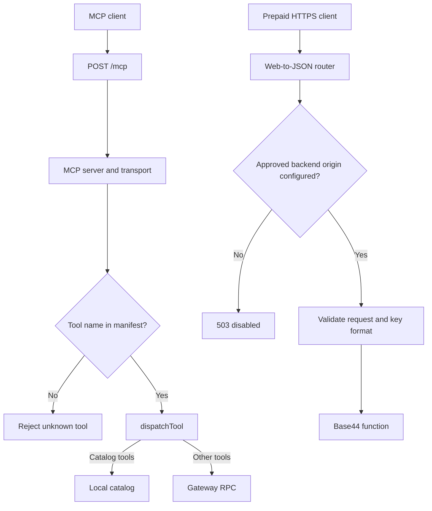

# Architecture

## Scope

This document describes the source baseline at commit 2c95ee6df98183d0e58d40a468fd595006aa591d. It is not a deployment attestation. The authentication implementation branch is separate and must be reviewed against its own commit.

## Components

| Component | Responsibility |
| --- | --- |
| src/http.ts | Express application, discovery routes, MCP HTTP transport, and router mounting |
| src/server.ts | MCP tool listing, tool-name allowlisting, and call-result wrapping |
| src/load-tools.ts | Load tool definitions from mcp-manifest.json |
| src/dispatch.ts | Resolve catalog tools locally and forward other calls |
| src/gateway.ts | Send requests to the configured or default gateway |
| src/web-to-json-router.ts | Separate prepaid HTTPS delivery adapter to Base44 |
| catalog.json | Published product data and checkout destinations |

## Request flow

There is no demonstrated MCP extraction-to-Base44 path in this baseline. Mounting an HTTP router does not register an MCP tool.

## Routes

| Route | Purpose |
| --- | --- |
| GET /.well-known/agent-card.json | Agent discovery document |
| GET /api/v1/catalog.json | Product catalog |
| GET /healthz | Process health and loaded-item counts |
| POST /mcp | MCP request processing |
| /v1/web-to-json/* | Prepaid HTTPS adapter operations |
| Pricing route | Separate x402-gated pricing operation |

The prepaid adapter is mounted before global JSON parsing. It exposes access, balance, extraction, and job operations. Balance and job reads use upstream GET requests. Access and extraction use upstream POST requests.

## Authority boundaries

Base44 is the designated authority for entitlements, balances, jobs, results, and settlement. The MCP layer must not introduce a competing credit ledger.

The existing adapter accepts buyer-key-shaped bearer credentials and forwards them to the fixed backend. Key-format validation is not proof of ownership, expiry, or entitlement. Those properties require backend enforcement and tests.

MCP OAuth access tokens and backend buyer credentials are separate. A future authenticated delivery dispatcher must validate the MCP token for this server, establish a request-local principal, resolve the authorized buyer binding, and use an independently resolved backend credential. Tool arguments must never choose the buyer or override credentials.

## Source-level controls and limitations

The prepaid adapter includes an exact approved-origin gate, operation-specific argument checks, an 8 KB body limit, a 1 MiB upstream JSON bound, redirect rejection, timeout and disconnect handling, and no automatic mutation retries. These source controls do not prove live behavior.

Authoritative page-fetch DNS, private-address, and redirect validation remains a backend responsibility. HTTPS URL syntax alone is not an SSRF defense.

At the baseline, gateway configuration has a default destination; lack of CODEX_GATEWAY_URL does not itself disable forwarding. Other known review areas include gateway HTTP-status handling, generic input-schema enforcement, error redaction, and the protocol version negotiated by the resolved SDK.

## Deployment configuration

- PORT selects the HTTP listening port, defaulting to 8080.
- WEB_TO_JSON_BACKEND_ORIGIN gates the prepaid adapter through an exact approved-origin comparison. Its deployed value is not established here.
- X402_ENABLED controls the separate payment router. Do not enable it as part of prepaid MCP delivery work.
- CODEX_GATEWAY_URL and CODEX_GATEWAY_TOKEN affect gateway forwarding. Do not expose credential values in logs or documentation.

Review Render's tracked branch and deployment configuration before merging or pushing changes that could trigger a deployment. No deployment is authorized by this document.
